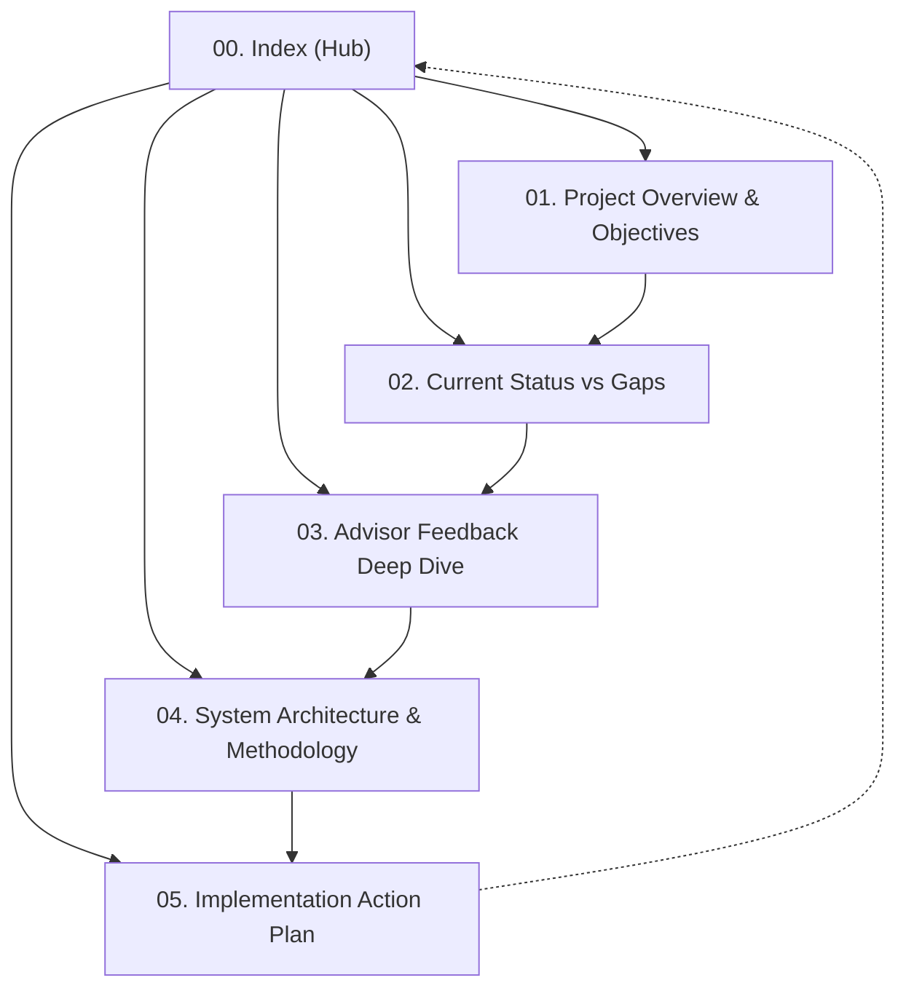

# 🚌 UniFlow EV: Second Brain Knowledge Base
> **Electric Shuttle Route and Fleet Scheduling Optimization for Thammasat University Rangsit Campus**
> โครงงานพัฒนาระบบวางแผนเส้นทางและจัดตารางเดินรถชัตเติลบัสไฟฟ้า มหาวิทยาลัยธรรมศาสตร์ ศูนย์รังสิต (CS303 Senior Project)

---

## 📌 แผนที่สารบัญความรู้ (Map of Content - MOC)

เอกสารในคลังความรู้นี้ถูกจัดโครงสร้างตามหลักการ **Second Brain (PARA / Linking Your Thinking)** เพื่อให้ติดตามสถานะ ข้อเสนอแนะ สถาปัตยกรรมระบบ และแผนการพัฒนาได้อย่างเป็นระบบและเชื่อมโยงกัน:

### 🗂️ รายการเอกสารหลัก (Core Notes)

| หมายเลข | เอกสาร | รายละเอียดสังเขป | สถานะ |
| :---: | :--- | :--- | :---: |
| **01** | [[01_Project_Overview_and_Objectives\|01. Project Overview & Objectives]] | ที่มา ปัญหา วัตถุประสงค์ ขอบเขตของโครงงานตาม Proposal CS303 และบริบทจริงของ มธ. รังสิต | `Completed` |
| **02** | [[02_Current_Status_vs_Remaining_Gaps\|02. Current Status vs Gaps]] | สถานะโค้ดปัจจุบัน (commit `eb367d8`), สิ่งที่ทำเสร็จแล้วเทียบกับช่องว่างที่ยังขาด | `Completed` |
| **03** | [[03_Advisor_Feedback_Deep_Dive\|03. Advisor Feedback Deep Dive]] | การวิเคราะห์และถอดรหัส Feedback ทั้ง 11 ข้อของอาจารย์ที่ปรึกษาและกรรมการ | `Completed` |
| **04** | [[04_System_Architecture_and_Methodology\|04. System Architecture & Methodology]] | สถาปัตยกรรมระบบ Data Pipeline, Metaheuristics, Simulation Engine, SUMO, Web UI | `Completed` |
| **05** | [[05_Implementation_Roadmap_and_Action_Plan\|05. Implementation Action Plan]] | แผนปฏิบัติงานทีละขั้น (Phase 1–6), การแก้โค้ดแต่ละโมดูล และ Checklist ตรวจสอบ | `Ready to Execute` |
| **06** | [[06_Input_and_Assumptions\|06. Input Data & Assumptions]] | แยก Input เป็น ข้อมูลจริง / อนุมาน / สมมติ พร้อม source และ impact (ตอบ feedback #4) | `Completed` |
| **07** | [[07_Fitness_Weights_Rationale\|07. Fitness Weights Rationale & Sensitivity]] | เหตุผลของน้ำหนัก fitness + ผลทดลอง sensitivity 8 แบบ (ตอบ feedback #1) | `Completed` |
| **08** | [[08_Fair_Benchmark_and_Fleet_Experiment\|08. Fair Benchmark & Fleet Sizing Experiment]] | แก้บั๊ก seed/repair, benchmark 500 evals × 5 seeds, ผลทดลองลดจำนวนรถ | `Completed` |

---

## 🎯 ภาพรวมและเป้าหมายสำคัญ (Executive Key Takeaway)

> [!IMPORTANT] หัวใจสำคัญของการปรับปรุงระบบรอบนี้
> ระบบต้องเปลี่ยนผ่านจาก **"การสุ่มความต้องการผู้โดยสารตามโอกาส (Random Generation)"** ไปสู่ **"แบบจำลองความต้องการจริงจากตารางเรียนและหอพัก (Timetable & Dormitory Driven Demand)"** โดยวัดผลความสำเร็จที่:
> 1. **การเข้าเรียนทันเวลา (Punctuality):** เข้าเรียนทันกี่คน, สายกี่คน, และสายเฉลี่ยกี่นาที
> 2. **ความคุ้มค่าของการใช้ทรัพยากร (Fleet Efficiency):** ให้บริการครอบคลุมโดยใช้จำนวนรถน้อยที่สุด
> 3. **การเปรียบเทียบอย่างเป็นธรรม (Fair Benchmark):** อัลกอริทึม (GA, SA, PSO, ACO) ต้องค้นหาบนตัวแปรและขอบเขตเดียวกัน

---

## 🏷️ Tags & Categories
- `#project/uniflow-ev` : บันทึกหลักของโครงงาน
- `#transit-optimization` : อัลกอริทึมและการหาค่าเหมาะสมของระบบขนส่ง
- `#simulation/sumo` : การจำลองระดับจุลภาคด้วย Eclipse SUMO
- `#simulation/discrete-event` : Discrete-Event Simulation ใน Python
- `#feedback/advisor` : ข้อเสนอแนะและทิศทางจากอาจารย์
- `#data/tu-rangsit` : ข้อมูลผังแม่บท หอพัก และตารางเรียน มธ. รังสิต
