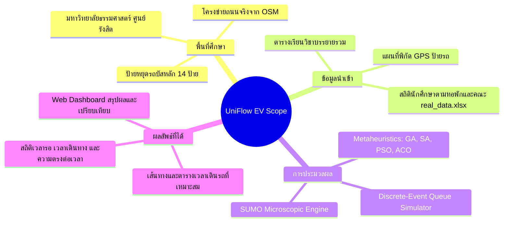

# 01. Project Overview & Objectives (ภาพรวมและวัตถุประสงค์โครงงาน)

> **เชื่อมโยง:** [[00_Index|หน้าหลัก]] | [[02_Current_Status_vs_Remaining_Gaps|สถานะงานและสิ่งที่ขาด]]

---

## 🏛️ 1. ที่มาและความสำคัญของปัญหา (Problem Statement)

มหาวิทยาลัยธรรมศาสตร์ ศูนย์รังสิต มีพื้นที่ขนาดใหญ่กว่า 1,757 ไร่ มีประชากรนักศึกษาและบุคลากรมากกว่า 40,000 คน โดยมีระบบรถบริการสาธารณะภายในมหาวิทยาลัย (Shuttle Bus / รถสองแถว และรถ EV Shuttle) เป็นหัวใจสำคัญในการเดินทางเชื่อมต่อระหว่าง:
1. **โซนที่พักอาศัย/หอพัก:** หอพักโซน B, โซน C, โซน F, หอพัก TU Dome และหอพักบุคลากร
2. **โซนอาคารเรียนรวมและคณะ:** อาคารบรรยายรวม (Lecture / LC1-LC5), กลุ่มวิทยาศาสตร์ (SC1-SC3), กลุ่มวิทยาศาสตร์สุขภาพ (Health Sciences), คณะพาณิชย์ฯ, นิติศาสตร์, ศิลปศาสตร์ ฯลฯ
3. **ประตูทางเข้าและจุดเชื่อมต่อภายนอก:** ประตูเชียงราก 1-2, ประตูพหลโยธิน, ท่ารถตู้/ขนส่งตึกโดม

### ปัญหาหลักในปัจจุบัน (Key Pain Points)
- **ความแออัดรุนแรงในช่วงเวลาเร่งด่วน (Peak Hours Congestion):** ช่วงเวลา 08:30–09:30 น. และ 12:30–13:30 น. นักศึกษาจำนวนมากต้องเดินทางจากหอพักไปยังอาคารเรียนพร้อมกัน ทำให้เกิดแถวคอยยาวนานที่ป้ายหอพัก และรถบัสเต็มความจุไม่สามารถรับผู้โดยสารได้ทั้งหมด
- **ปัญหาการเข้าเรียนสาย (Student Tardiness):** ความไม่แน่นอนของรอบรถ (Headway variability) และเวลารอคอย ทำให้ผู้โดยสารคำนวณเวลาเดินทางได้ยาก ส่งผลให้นักศึกษาเข้าเรียนสาย เสียโอกาสทางการเรียนรู้
- **การจัดสรรทรัพยากรไม่สมดุล (Resource Misallocation):** บางเส้นทางมีรถวิ่งวนโดยไม่มีผู้โดยสาร (Deadhead / Empty run) ในขณะที่เส้นทางหลักมีรถไม่เพียงพอ การเพิ่มจำนวนรถโดยไม่มีการวางแผนก่อให้เกิดต้นทุนค่าใช้จ่ายและการใช้พลังงานไฟฟ้าโดยเปล่าประโยชน์
- **ข้อจำกัดของระบบรถไฟฟ้า (EV Constraints):** รถบัสไฟฟ้ามีขีดจำกัดด้านระยะทางต่อการชาร์จ (Range anxiety) ความจุแบตเตอรี่ และจำเป็นต้องมีเวลาพัก/ชาร์จที่ Depot

---

## 🎯 2. วัตถุประสงค์ของโครงงาน (Project Objectives)

อ้างอิงจากข้อเสนอโครงงานปริญญานิพนธ์ (CS303 Proposal):

1. **เพื่อพัฒนาแบบจำลองและอัลกอริทึมการหาค่าเหมาะสมที่สุด (Optimization Algorithms):**
   - นำเทคนิค Metaheuristics ได้แก่ **Genetic Algorithm (GA)**, **Simulated Annealing (SA)**, **Particle Swarm Optimization (PSO)**, และ **Ant Colony Optimization (ACO)** มาประยุกต์ใช้ในการจัดเส้นทาง (Route Design), ความถี่ของรอบรถ (Headway), และจำนวนรถประจำเส้นทาง (Fleet Allocation)
2. **เพื่อสร้างระบบจำลองการเดินทางเสมือนจริง (Multi-level Simulation):**
   - **ระดับ Discrete-Event Simulation (DES):** จำลองคิวการรอของผู้โดยสารที่ป้าย และเวลาเดินทางบนรถอย่างรวดเร็วเพื่อใช้เป็น Fitness Function ในการประเมินคำตอบ
   - **ระดับ Microscopic Traffic Simulation (SUMO):** จำลองพฤติกรรมการเคลื่อนที่ของรถบัสบนโครงข่ายถนนจริงของ มธ. รังสิต ผ่าน OpenStreetMap (OSM) เพื่อยืนยันสภาพการจราจรและเวลาเดินทาง
3. **เพื่อประเมินผลสัมฤทธิ์ตามความต้องการจริง (Demand-Driven Evaluation):**
   - พัฒนากลไกจำลองความต้องการเดินทางจาก **ข้อมูลการกระจายตัวของนักศึกษาในหอพัก (`real_data.xlsx`)** และ **ตารางเรียนของมหาวิทยาลัย**
   - วัดผลทั้งในมิติ **เวลารอคอย (Waiting Time)**, **เวลาเดินทาง (Travel Time)**, **อัตราการเข้าเรียนทันเวลา (On-time Arrival Rate)**, และ **การลดจำนวนรถ (Resource Minimization)**
4. **เพื่อพัฒนาระบบแดชบอร์ดแสดงผลการตัดสินใจ (Interactive Web Application):**
   - ให้ผู้บริหารและผู้จัดตารางเดินรถสามารถเปรียบเทียบผลลัพธ์ของแต่ละอัลกอริทึม ตรวจสอบตารางเดินรถแบบละเอียด (Detailed Timetable) และวิเคราะห์สถิติประสิทธิภาพผ่าน UI ที่ใช้งานง่าย

---

## 📐 3. ขอบเขตของโครงงาน (Project Scope)

### 1. โครงข่ายและป้ายหยุดรถ (Stops & Network)
ครอบคลุม 14 ป้ายสำคัญทั่วมหาวิทยาลัย:
- `Dome`, `Hospital`, `Dorm` (โซนหอพัก B, C, F), `Gate1`, `Library`, `Park`, `SC1`, `SC2_SC3`, `Green`, `Convention`, `Terminal`, `Lecture` (อาคารบรรยายรวม), `Health` (กลุ่มวิทยาศาสตร์สุขภาพ), `Social` (กลุ่มสังคมศาสตร์)

### 2. กลุ่มผู้ใช้งานและยานพาหนะ (Fleet & Passengers)
- **ยานพาหนะ:** รถชัตเติลบัสไฟฟ้า (EV Shuttle Bus) ความจุมาตรฐาน 30 ที่นั่ง/คัน ความเร็วเฉลี่ยในการให้บริการ 50 กม./ชม. (คำนึงถึง Dwell time 1.5 นาทีต่อป้าย และ Layover time 5 นาทีที่สถานีปลายทาง)
- **ผู้โดยสาร:** นักศึกษาที่เดินทางจากหอพักไปยังอาคารเรียนในช่วงเช้าและบ่าย

### 3. ตัวชี้วัดความสำเร็จ (Key Performance Indicators - KPIs)
1. **Average Passenger Waiting Time (นาที):** เวลาเฉลี่ยที่ผู้โดยสารต้องยืนรอที่ป้าย
2. **Average Travel Time (นาที):** เวลาเฉลี่ยที่ผู้โดยสารอยู่บนรถจนถึงปลายทาง
3. **Punctuality / On-Time Rate (%):** ร้อยละของผู้โดยสารที่ไปถึงอาคารเรียนก่อนเริ่มเรียน
4. **Average Delay (นาที):** จำนวนนาทีเฉลี่ยที่ผู้โดยสารเข้าเรียนสาย (เฉพาะผู้ที่สาย)
5. **Served vs Unserved Rate (%):** สัดส่วนผู้โดยสารที่ได้ขึ้นรถเทียบกับผู้โดยสารที่ตกค้างที่ป้าย
6. **Fleet Size (คัน):** จำนวนรถบัสรวมที่ต้องใช้ในระบบ

---

## 👥 4. ผู้มีส่วนได้ส่วนเสีย (Stakeholders)
- **นักศึกษาและบุคลากร มธ.:** ได้รับบริการรถบัสที่ตรงเวลา ลดเวลาการยืนรอ ไม่เข้าเรียนหรือทำงานสาย
- **กองบริหารศูนย์รังสิต / ฝ่ายจัดการยานพาหนะ:** สามารถจัดสรรงบประมาณ จำนวนรถ และคนขับได้อย่างมีประสิทธิภาพสูงสุด ลดค่าใช้จ่ายพลังงานไฟฟ้า
- **คณะวิทยาศาสตร์และเทคโนโลยี / ภาควิชาวิทยาการคอมพิวเตอร์:** ได้งานวิจัยประยุกต์ด้าน Operational Research, Simulation, และ Smart Mobility ที่นำไปต่อยอดได้จริง
