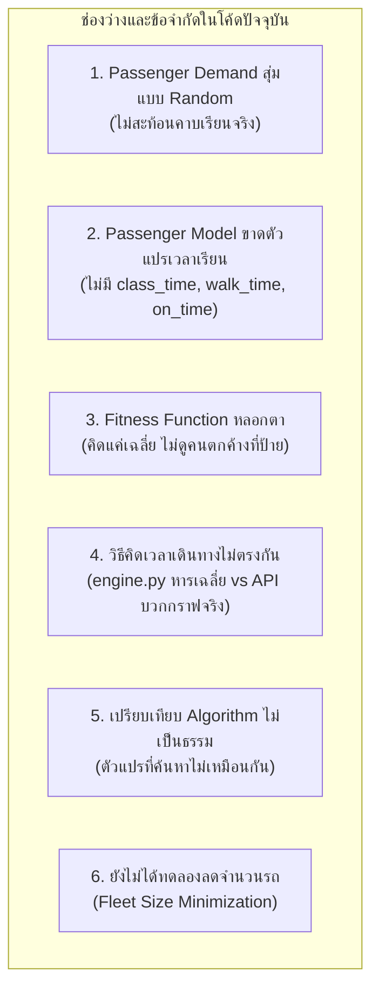

# 02. Current Status vs. Remaining Gaps (สถานะงานปัจจุบัน vs สิ่งที่ยังขาด)

> **เชื่อมโยง:** [[00_Index|หน้าหลัก]] | [[01_Project_Overview_and_Objectives|ภาพรวมและวัตถุประสงค์]] | [[03_Advisor_Feedback_Deep_Dive|เจาะลึก Feedback อาจารย์]]

---

## 📊 1. ตารางสรุปภาพรวมสถานะงาน (Executive Progress Matrix)

ประเมินจากฐานโค้ดล่าสุดบน Git Commit `eb367d8` (origin/main):

| องค์ประกอบระบบ | สถานะปัจจุบัน | ความสมบูรณ์ (%) | ประเด็นหลักที่ต้องปรับปรุง |
| :--- | :---: | :---: | :--- |
| **1. ผังโครงข่ายและระยะทาง (Graph & Map)** | 🟢 เสร็จสิ้น | 95% | พิกัดจริง 14 ป้าย, ระยะทาง Haversine คำนวณถูกต้อง, OSM พร้อมใช้งาน |
| **2. อัลกอริทึมค้นหา (Metaheuristics)** | 🟡 ใช้งานได้บางส่วน | 70% | มี GA, SA, PSO, ACO แล้ว แต่ขอบเขตตัวแปร (Search Space) ยังไม่เท่ากัน |
| **3. แบบจำลองความต้องการ (Demand Model)** | 🔴 ต้องรื้อปรับปรุง | 35% | ปัจจุบันสุ่มตาม `STOP_WEIGHTS` ยังไม่ได้เชื่อมตารางเรียนและหอพักจริง |
| **4. แบบจำลองคิว (Discrete-Event Sim)** | 🟡 ใช้งานได้แต่ขาดตัวแปร | 60% | มีคิวขึ้น/ลงรถ แต่ขาดการคำนวณเวลาเดินถึงอาคาร และสถานะทัน/สาย |
| **5. ฟังก์ชันเป้าหมาย (Fitness Function)** | 🔴 มีจุดบกพร่องเชิงตรรกะ | 30% | คิดแค่เวลารอ+เวลาเดินทางเฉลี่ย ละเลยคนตกค้างและการเข้าเรียนสาย |
| **6. การจำลองระดับจุลภาค (SUMO Sim)** | 🟡 รันรถได้ แต่ยังไม่มีคน | 65% | รันรถบัสตามเส้นทางได้บนเน็ตเวิร์กจริง แต่ยังไม่เชื่อมโยง Passenger ใน SUMO |
| **7. เว็บแดชบอร์ด (Web Frontend & API)** | 🟢 สวยงามและสมบูรณ์ | 90% | มี Map, Recharts, ตารางเดินรถละเอียด, รองรับรันและเทียบผลอัลกอริทึม |
| **โดยรวมทั้งโปรเจกต์** | 🟡 **พร้อมใช้งาน 65%** | **~65%** | **แกนหลักทำงานได้ รอเชื่อม Demand ตารางเรียน + Goal function ใหม่** |

---

## ✅ 2. รายละเอียดสิ่งที่ทำเสร็จสมบูรณ์แล้ว (What is Completed)

### 2.1 ฐานข้อมูลโครงข่ายและแผนที่ (Campus Network)
- **พิกัด GPS จริง:** กำหนดพิกัดละติจูด-ลองจิจูดของ 14 ป้ายหลักใน `src/config/settings.py` และ `src/data/graph.py`
- **การคำนวณระยะทางแม่นยำ:** ใช้สูตร **Haversine Formula** ในการคำนวณระยะทางจริงระหว่างป้าย และแปลงเป็นความเร็วเดินทางเฉลี่ย 50 กม./ชม.
- **โครงข่าย OpenStreetMap (OSM):** ไฟล์เครือข่ายถนนจริงของ มธ. รังสิต (`thammasat.net.xml`, `thammasat.poly.xml`, `bus_stops.add.xml`)

### 2.2 อัลกอริทึม Metaheuristics
- มีการนำ 4 อัลกอริทึมมาพัฒนาในโมดูล `src/algorithms/`:
  - **GA (Genetic Algorithm):** มี Crossover, Mutation, Selection
  - **SA (Simulated Annealing):** มี Temperature Cooling Schedule
  - **PSO (Particle Swarm Optimization):** ปรับความเร็วและตำแหน่งของอนุภาค
  - **ACO (Ant Colony Optimization):** ปล่อยมดและอัปเดตฟีโรโมนบนเส้นทาง
- มีสคริปต์ Benchmark อัตโนมัติ (`run_benchmark.py`) บันทึกผลลัพธ์เป็น JSON

### 2.3 การปรับแต่งและแก้ปัญหา Eclipse SUMO
- แก้ไขปัญหา Path Resolution สำหรับ Mac (ARM64 / Apple Silicon):
  - หลีกเลี่ยงตัวเรียก Anaconda ที่ชำรุด โดยตรวจหาไบนารีเนทีฟใน `.venv/lib/python3.13/site-packages/sumo/bin/sumo-gui`
  - รองรับการตั้งค่า `SUMO_HOME` และตัวแปรสิ่งแวดล้อม `DISPLAY` สำหรับรันบน XQuartz
  - สามารถสั่งรัน SUMO-GUI ได้โดยตรงจาก Web Interface ผ่าน FastAPI Endpoint `/api/simulation/run-sumo`

### 2.4 เว็บแอปพลิเคชันและหน้าแดชบอร์ด (Next.js Frontend)
- หน้า UI สวยงามตามมาตรฐานวิศวกรรมซอฟต์แวร์:
  - **CampusTransitMap:** แผนที่ Leaflet แสดงตำแหน่งป้ายรถบัสและเส้นทางเดินรถแบบโต้ตอบได้
  - **BenchmarkComparisonChart:** กราฟแท่งและสไปเดอร์ชาร์ตเปรียบเทียบ Wait Time, Travel Time, Total Time ระหว่าง Baseline, GA, SA, PSO, ACO
  - **RouteFleetCharts:** กราฟสัดส่วนจำนวนรถบัสและรอบเวลาของแต่ละเส้นทาง
  - **Detailed Timetable Modal:** ตารางแสดงเวลาที่รถจะถึงแต่ละป้ายอย่างแม่นยำ

---

## ⚠️ 3. การวิเคราะห์จุดบกพร่องและสิ่งที่ยังขาด (Gap Analysis)

จากการตรวจทานโค้ดอย่างละเอียดร่วมกับข้อเสนอแนะของอาจารย์ที่ปรึกษา พบ 6 ช่องว่างสำคัญทางเทคนิคที่ต้องแก้ไข:



### 🔴 ช่องว่างที่ 1: การสร้างผู้โดยสารยังเป็นการสุ่ม (Random Synthetic Demand)
- **สภาพปัจจุบัน:** ใน `src/simulation/engine.py` ฟังก์ชัน `generate_passengers(t)` สุ่มต้นทางและปลายทางจาก `STOP_WEIGHTS` และใช้ความน่าจะเป็น 0.8 ในชั่วโมงเร่งด่วน
- **ปัญหา:** ไม่สะท้อนพฤติกรรมจริงของนักศึกษา มธ. ซึ่งจะออกจากหอพัก (Zone B, C, F, TU Dome) ในช่วง 15–30 นาทีก่อนเวลาเริ่มเรียน (เช่น ก่อน 09:00 น. หรือ 13:30 น.) มุ่งหน้าไปยังอาคารเรียนรวม (SC, LC, Health)
- **สิ่งที่ต้องทำ:** นำข้อมูลจาก `data/raw/real_data.xlsx` (จำนวนนักศึกษาแต่ละคณะตามหอพัก) มาสร้าง Origin-Destination (O-D) Matrix อิงตามตารางเรียนจริง

### 🔴 ช่องว่างที่ 2: โมเดลผู้โดยสารไม่มีข้อมูลเวลาเรียนและการเดิน
- **สภาพปัจจุบัน:** ใน `src/simulation/Passenger.py` มีเพียง:
  ```python
  self.origin = origin
  self.destination = destination
  self.arrival_time = arrival_time
  self.board_time = None
  self.drop_time = None
  ```
- **ปัญหา:** ไม่สามารถตอบคำถามสำคัญที่สุดของอาจารย์ได้ คือ **"นักศึกษาไปเรียนทันกี่คน สายกี่คน และสายกี่นาที?"**
- **สิ่งที่ต้องทำ:** เพิ่มฟิลด์:
  - `class_start_time`: เวลาเริ่มเรียนของคาบ
  - `walk_time_minutes`: เวลาเดินจากป้ายรถบัสถึงห้องเรียน/อาคาร
  - `target_arrival_time`: เวลาที่ต้องการถึงก่อนเรียน (เช่น เผื่อเวลา 10 นาที)
  - `is_on_time`, `delay_minutes`: สถานะการมาทันและการสาย

### 🔴 ช่องว่างที่ 3: ฟังก์ชันเป้าหมาย (Fitness Function) มีความเอนเอียง
- **สภาพปัจจุบัน:** ใน `src/optimization/fitness.py`:
  ```python
  return 0.5 * norm_wait + 0.5 * norm_travel
  ```
- **ปัญหา:** **อันตรายอย่างยิ่งในการวัดผล!** หากเส้นทางหนึ่งให้บริการผู้โดยสารเพียง 2 คนที่ขึ้นรถแล้วถึงทันที (เวลารอ 1 นาที, เวลาเดินทาง 2 นาที) แต่ปล่อยให้ผู้โดยสารอีก 500 คนยืนเคว้งคว้างอยู่ที่ป้าย ค่า `avg_wait_time` และ `avg_travel_time` จะต่ำมาก ทำให้ระบบเข้าใจผิดว่าเส้นทางนี้ "ดีเลิศ" (Optimal)
- **สิ่งที่ต้องทำ:** ปรับเป็น **Multi-Objective Cost Function** ที่รวม:
  1. โทษผู้โดยสารตกค้าง (Unserved / Stranded Penalty)
  2. โทษการเข้าเรียนสาย (Lateness Penalty ตามจำนวนนาทีที่สาย)
  3. ต้นทุนจำนวนรถที่ใช้ (Fleet Size / Resource Cost)

### 🔴 ช่องว่างที่ 4: การคำนวณเวลาเดินทางใน Simulation กับ API ขัดแย้งกัน
- **สภาพปัจจุบัน:**
  - ใน `engine.py`: ใช้เวลารอบรถหารเฉลี่ยจำนวนป้าย `travel_time = cycle_time / (len(route) - 1)`
  - ใน `api_server.py`: ใช้ระยะทางจากกราฟจริงบวก Dwell Time 1.5 นาทีต่อป้าย
- **ปัญหา:** ผลลัพธ์เวลาเดินทางใน Simulation ไม่ตรงกับตารางเดินรถจริงที่แสดงบนหน้าเว็บ
- **สิ่งที่ต้องทำ:** รวมศูนย์การคำนวณให้ `engine.py` ดึงค่าน้ำหนักจริงจาก Network Graph + Dwell Time ประจำป้าย

### 🔴 ช่องว่างที่ 5: การเปรียบเทียบอัลกอริทึมยังไม่ตั้งอยู่บนขอบเขตเดียวกัน
- **สภาพปัจจุบัน:** GA และ SA พยายามสุ่มเปลี่ยนลำดับป้ายในเส้นทาง ขณะที่ PSO ปรับแต่งเฉพาะความถี่/รอบเวลาบนเส้นทางเดิม (Fixed Routes)
- **ปัญหา:** ขอบเขตการค้นหา (Decision Space) ต่างกัน ทำให้สรุปไม่ได้ว่าอัลกอริทึมใดเก่งกว่ากันในเชิงวิทยาการ
- **สิ่งที่ต้องทำ:** กำหนด Decision Variables ให้ชัดเจน (เช่น ค้นหา Frequency/Headway และ Fleet Size บน Candidate Routes ชุดเดียวกัน หรือค้นหา Route Sequence ด้วย Representation เดียวกัน)

### 🔴 ช่องว่างที่ 6: การจำลอง SUMO ยังเป็นเพียงภาพรถวิ่ง
- **สภาพปัจจุบัน:** `generate_real_schedule.py` สร้างเฉพาะ `<vehicle>` ของรถบัสวิ่งตามรอบเวลา แต่ไม่มี `<person>` หรือ `<personTrip>` ขึ้นรถจริงใน SUMO
- **สิ่งที่ต้องทำ:** นำผู้โดยสารจากความต้องการจริงใส่ลงใน SUMO หรือใช้ TraCI ตรวจสอบการรับ-ส่งที่ป้ายจริง
