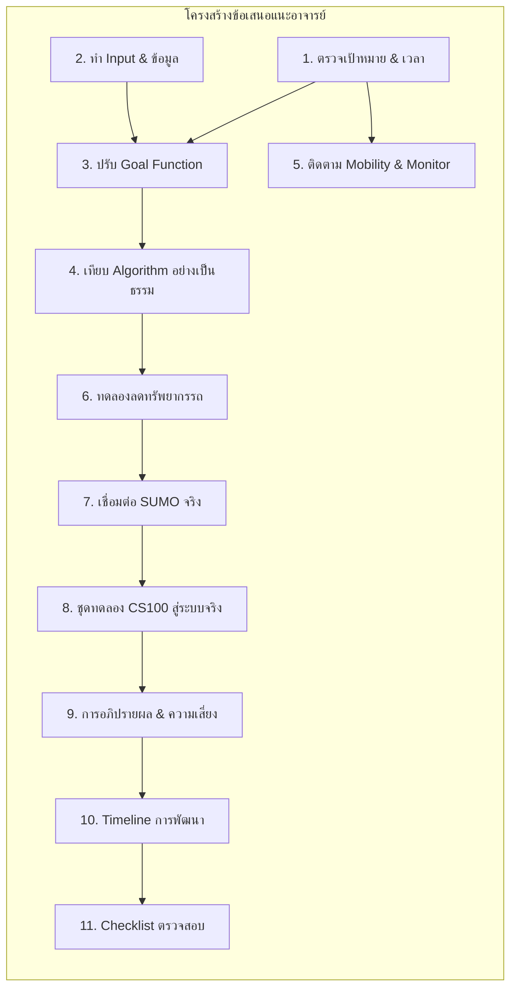

# 03. Advisor Feedback Deep Dive (การวิเคราะห์ข้อเสนอแนะอาจารย์ 11 หัวข้อ)

> **เชื่อมโยง:** [[00_Index|หน้าหลัก]] | [[02_Current_Status_vs_Remaining_Gaps|สถานะงานและสิ่งที่ขาด]] | [[04_System_Architecture_and_Methodology|สถาปัตยกรรมระบบ]]

เอกสารนี้ถอดรหัสและวิเคราะห์ข้อเสนอแนะจากอาจารย์ที่ปรึกษา (ผศ.ดร.ปกป้อง ส่องเมือง) และคณะกรรมการสอบโครงงานอย่างละเอียด เพื่อนำมาใช้เป็นแนวทางมาตรฐานในการปรับปรุงระบบ UniFlow EV

---

## 🧭 สรุปสาระสำคัญของ Feedback ทั้ง 11 ส่วน

---

## 🔍 วิเคราะห์เจาะลึกรายข้อ (Section-by-Section Analysis)

### 📌 หัวข้อที่ 1: ตรวจเป้าหมายและการคำนวณเวลา (Goal & Time Verification)
- **ประเด็นของอาจารย์:** ระบบเดิมวัดแค่ค่าเฉลี่ยเวลารอและเวลาเดินทาง แต่ไม่สามารถตอบได้ว่าผู้โดยสารไปถึงทันเริ่มเรียนหรือไม่
- **หลักการคำนวณเวลาที่ถูกต้อง:**
  $$\text{เวลาถึงอาคาร} = \text{เวลาลงรถที่ป้ายปลายทาง} + \text{เวลาเดินเท้าจากป้ายถึงอาคาร}$$
  $$\text{จำนวนนาทีที่สาย} = \max(0, \text{เวลาถึงอาคาร} - \text{เวลาเริ่มเรียน})$$
- **เกณฑ์การแยกแยะ:**
  - *ถึงก่อนเริ่มเรียน (On-time):* $\text{เวลาถึงอาคาร} \le \text{เวลาเริ่มเรียน}$
  - *ถึงก่อนเวลาที่เผื่อไว้ (Comfortable Arrival):* $\text{เวลาถึงอาคาร} \le \text{เวลาเริ่มเรียน} - \text{Buffer Time}$ (เช่น เผื่อ 10 นาที)
- **การรวมศูนย์เวลาเดินทาง:** เลิกใช้การหารเฉลี่ยเวลารอบรถ แต่ใช้เวลาระหว่างป้ายจริงจากกราฟถนน + เวลาจอดรับส่ง (Dwell time 1.5 นาที)

---

### 📌 หัวข้อที่ 2: จัดทำ Input และสมมติฐานให้ตรวจสอบได้ (Auditable Input & Assumptions)
- **ประเด็นของอาจารย์:** ข้อมูล Demand ต้องมีที่มาที่ไป ไม่ใช่นึกตัวเลขขึ้นมาเอง
- **ข้อมูลนำเข้าจริง:**
  1. **สถิติการพักอาศัยของนักศึกษา (`data/raw/real_data.xlsx`):** จำนวนนักศึกษาจริงแบ่งตามหอพัก (B03-B08, C01-C11, F03-F07, M01-M02) และคณะ
  2. **ตารางเรียนของมหาวิทยาลัย:** คาบเรียนบรรยายรวม (09:00, 09:30, 11:00, 13:30, 15:00 น.)
  3. **การจับคู่ป้ายกับอาคาร:**
     - โซนหอพัก $\rightarrow$ ป้าย `Dorm`
     - คณะวิศวะ, วิดยา, สถิติ $\rightarrow$ ป้าย `SC1`, `SC2_SC3`
     - อาคารบรรยายรวม LC $\rightarrow$ ป้าย `Lecture`
     - คณะแพทย์, สหเวช, พยาบาล $\rightarrow$ ป้าย `Health`, `Hospital`
     - คณะสังคมศาสตร์, ศิลปศาสตร์, นิติศาสตร์ $\rightarrow$ ป้าย `Social`
  4. **สมมติฐานการเดินเท้า:** ระยะทางเฉลี่ย 100–300 เมตร คิดความเร็วเดิน 1.2 เมตร/วินาที (ประมาณ 2–4 นาทีต่อการเดินเข้าตึก)

---

### 📌 หัวข้อที่ 3: ปรับปรุงฟังก์ชันเป้าหมาย (Multi-Objective Goal Function)
- **ประเด็นของอาจารย์:** ฟังก์ชัน Fitness เดิมคิดแค่ `0.5 * wait + 0.5 * travel` หากรถรับคนได้แค่ 5 คนแล้ววิ่งฉิว คะแนนจะดีหลอกตา ต้องลงโทษเมื่อมีคนตกค้าง
- **สูตร Goal Function ใหม่ที่อาจารย์แนะนำ:**
  $$\text{Total Cost} = w_1 \cdot \overline{T}_{\text{wait}} + w_2 \cdot \overline{T}_{\text{travel}} + w_3 \cdot \overline{T}_{\text{delay}} + P_{\text{unserved}} \cdot N_{\text{unserved}} + C_{\text{fleet}} \cdot N_{\text{buses}}$$
  โดยที่:
  - $\overline{T}_{\text{wait}}$: เวลาเฉลี่ยที่ยืนรอที่ป้าย
  - $\overline{T}_{\text{travel}}$: เวลาเฉลี่ยบนรถ
  - $\overline{T}_{\text{delay}}$: จำนวนนาทีเฉลี่ยที่เข้าเรียนสาย
  - $N_{\text{unserved}}$: จำนวนผู้โดยสารที่ตกค้างอยู่ที่ป้ายเมื่อสิ้นสุดคาบเวลา (High Penalty เช่น ปรับหัวละ 60 นาที)
  - $N_{\text{buses}}$: จำนวนรถบัสที่ใช้ในระบบ (Resource Cost เพื่อผลักดันให้ลดจำนวนรถ)

---

### 📌 หัวข้อที่ 4: การเปรียบเทียบอัลกอริทึมอย่างเป็นธรรม (Fair Benchmarking)
- **ประเด็นของอาจารย์:** ปัจจุบันเปรียบเทียบ GA, SA, PSO, ACO โดยตัวแปรค้นหาไม่เหมือนกัน และยังไม่มีการทำซ้ำ (Replication)
- **เกณฑ์มาตรฐานในการ Benchmark:**
  1. **ตัวแปรค้นหาเดียวกัน (Standardized Decision Variables):** ทุกอัลกอริทึมต้องค้นหาบนตัวแปรเดียวกัน เช่น:
     - ความถี่ของรอบรถ (Headway) ของแต่ละสาย
     - จำนวนรถประจำแต่ละสาย (Fleet size)
     - เวลาเริ่มปล่อยรถคันแรก (Start time)
  2. **งบประมาณการค้นหาเท่ากัน (Computational Budget):** กำหนดจำนวนครั้งที่ประเมิน Fitness Function ให้เท่ากัน เช่น 500 หรือ 1,000 Evaluations
  3. **การทำซ้ำ 5–10 Runs ด้วย Random Seeds ต่างกัน:** รายงานค่า Mean, Std, Best, Worst เพื่อยืนยันว่าผลลัพธ์ไม่ได้เกิดจากความบังเอิญ
  4. **กราฟการลู่เข้า (Convergence Curves):** พล็อตแนวโน้มของ Fitness Score ตามจำนวน Iteration

---

### 📌 หัวข้อที่ 5: ติดตาม Mobility และสร้างระบบ Monitor (Mobility Dashboard)
- **ประเด็นของอาจารย์:** ต้องการเห็นสภาพการเคลื่อนที่ของทั้งรถและคนตามเวลาจริง
- **สิ่งที่ต้องแสดงผลบนหน้าเว็บ:**
  1. **สถิติรายป้าย (Per-Stop Queue Metrics):** จำนวนคนที่สะสมในแต่ละนาที และจำนวนคนที่ขึ้นรถสำเร็จ
  2. **การใช้งานรถ (Vehicle Utilization):** สัดส่วนที่นั่งที่ถูกใช้งาน (Occupancy Rate) ของรถแต่ละคันในแต่ละช่วงเวลา
  3. **สถานะการเข้าเรียน (Punctuality Breakdown):** แผนภูมิวงกลม/แท่งแสดง สัดส่วนถึงทัน (On-time), ถึงฉิวเฉียด (Near-time), และสาย (Late)

---

### 📌 หัวข้อที่ 6: การทดลองลดทรัพยากร (Fleet Size Minimization Experiment)
- **ประเด็นของอาจารย์:** "สามารถลดจำนวนรถบัสลงได้กี่คัน โดยที่ระดับบริการ (Service Level) ยังไม่ตก?"
- **การออกแบบการทดลอง:**
  - ทดลองกำหนดเพดานจำนวนรถรวม เช่น 20 คัน $\rightarrow$ 16 คัน $\rightarrow$ 12 คัน $\rightarrow$ 8 คัน
  - ดูจุดเปลี่ยน (Trade-off Curve): จุดใดที่เวลารอเริ่มพุ่งสูง หรือผู้โดยสารเริ่มเข้าเรียนสายเกินเกณฑ์ยอมรับได้ (เช่น สายเกิน 5%)
  - กำหนดเวลาพักปลายรอบ (Layover / Break Time) 5–10 นาที เพื่อความสมจริงในการสับเปลี่ยนคนขับและการระบายความร้อนของรถ EV

---

### 📌 หัวข้อที่ 7: การเชื่อมโยงกับ SUMO อย่างแท้จริง (Microscopic Simulation)
- **ประเด็นของอาจารย์:** SUMO ไม่ควรเป็นแค่ภาพรถวิ่งโชว์ แต่ต้องสะท้อนปฏิสัมพันธ์จริง
- **แนวทางเชื่อมโยง:**
  - สร้างไฟล์ความต้องการผู้โดยสารใน SUMO ผ่านแท็ก `<person>` หรือ `<personTrip>`
  - กำหนดให้คนเดินมาที่ `<busStop>` ตามเวลาตารางเรียน และขึ้นรถบัส `<ride busStop="..." lines="...">`
  - เปรียบเทียบความเร็วและเวลาเดินทางที่คำนวณได้จาก Python Discrete-Event Sim กับค่าจริงที่วัดได้จาก SUMO Output (`tripinfo.xml`)

---

### 📌 หัวข้อที่ 8: ลำดับการทดลองและชุดทดลองนำร่อง (Pilot Testbed: CS100)
- **ประเด็นของอาจารย์:** อย่าเพิ่งกระโดดไปทำทั้งมหาวิทยาลัยพร้อมกันทั้งหมด ให้เริ่มจากชุดข้อมูลขนาดเล็กที่คุมตัวแปรได้ก่อน
- **ชุดทดลองระดับที่ 1 (Micro Testbed - คลาส CS100):**
  - นศ. วิชา CS100 จำนวน 150 คน พักที่หอพักโซน B และ C มีเรียนตอน 09:00 น. ที่อาคาร SC2
  - ป้ายต้นทาง: `Dorm`, ป้ายปลายทาง: `SC2_SC3`
  - ตรวจสอบว่าระบบจัดรถมารับได้หมดหรือไม่ มีคนสายกี่คน
- **ชุดทดลองระดับที่ 2 (Macro Testbed - มธ. ทั้งระบบ):**
  - นำ Demand เต็มรูปแบบจากทุกหอพักและทุกคณะมาจำลองการเดินทางรอบเช้า (07:30–09:30 น.)

---

### 📌 หัวข้อที่ 9: การอภิปรายผลและความเสี่ยง (Discussion & Trade-offs)
- วิเคราะห์ความสัมพันธ์ระหว่าง **ต้นทุนการเดินรถ (จำนวนรถ)** กับ **คุณภาพการบริการ (เวลารอและความตรงต่อเวลา)**
- วิเคราะห์ความทนทานของระบบ (Robustness): หากมีรถเสีย 1 คัน หรือมีฝนตกทำให้คนเดินทางช้าลง ระบบจะรับมือได้อย่างไร

---

### 📌 หัวข้อที่ 10 & 11: แผนงานและตารางตรวจความพร้อม (Action Plan & Checklist)
- แปลงข้อเสนอแนะทั้งหมดให้เป็น **ลำดับขั้นตอนการปฏิบัติงานทางวิศวกรรมซอฟต์แวร์** (ดูรายละเอียดใน [[05_Implementation_Roadmap_and_Action_Plan|05. แผนปฏิบัติงานและ Checklist]])
