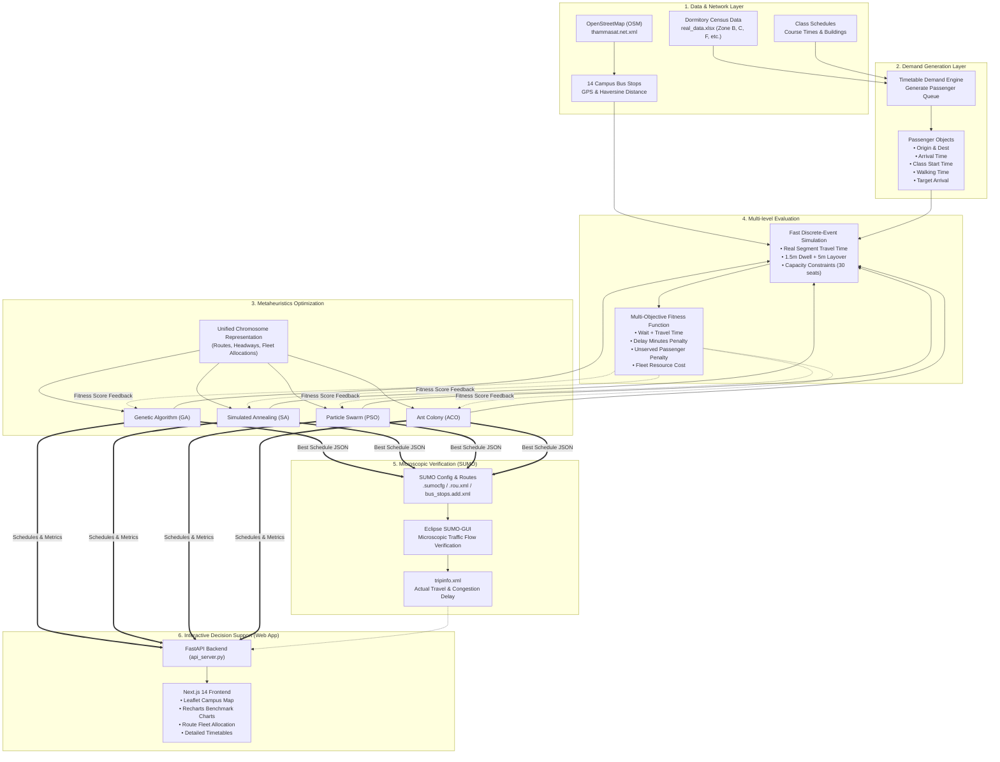
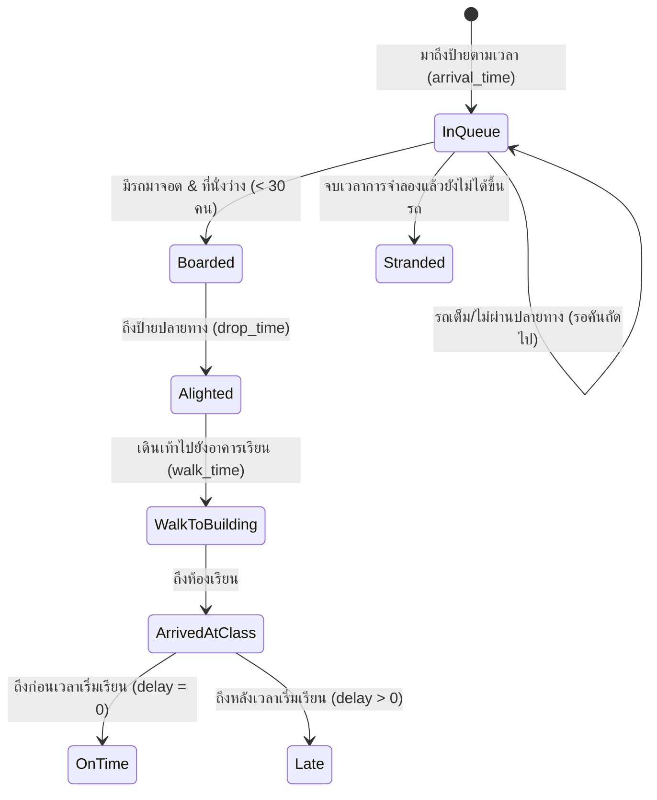

# 04. System Architecture and Methodology (สถาปัตยกรรมระบบและระเบียบวิธีวิจัย)

> **เชื่อมโยง:** [[00_Index|หน้าหลัก]] | [[03_Advisor_Feedback_Deep_Dive|เจาะลึก Feedback อาจารย์]] | [[05_Implementation_Roadmap_and_Action_Plan|แผนปฏิบัติงาน]]

เอกสารนี้สรุปสถาปัตยกรรมทางเทคนิคของระบบ **UniFlow EV** ทั้งกระบวนการส่งผ่านข้อมูล (Data Pipeline), การออกแบบโครโมโซม, กลไกจำลองคิว, การประเมินคะแนน และการเชื่อมต่อระดับจุลภาค

---

## 🏗️ 1. สถาปัตยกรรมภาพรวมของระบบ (End-to-End System Architecture)

---

## 🧬 2. การออกแบบโครโมโซมและตัวแปรค้นหา (Chromosome Representation)

เพื่อให้การเปรียบเทียบระหว่าง **GA, SA, PSO, ACO** เป็นไปอย่างยุติธรรมตามข้อเสนอแนะของอาจารย์ โครงสร้างตัวแปรต้องถูกกำหนดเป็นมาตรฐานเดียวกัน:

### 2.1 ขอบเขตตัวแปรในการตัดสินใจ (Decision Variables)
สำหรับโครงข่ายที่มี $K$ เส้นทางเดินรถ (Candidate Routes):
1. **$R_k$ (Route Sequence):** ลำดับป้ายที่รถวิ่งในสายที่ $k$ (เช่น `[Dorm, Gate1, SC1, SC2_SC3, Lecture, Health, Dorm]`)
2. **$H_k$ (Headway):** ความถี่หรือระยะห่างระหว่างคัน (เช่น $5, 10, 15, 20$ นาที)
3. **$N_k$ (Fleet Allocation):** จำนวนรถบัสที่จัดสรรให้สายที่ $k$ (เช่น $1, 2, 3, 4$ คัน)
4. **$T_{start, k}$ (Service Start Time):** เวลาเริ่มปล่อยรถคันแรกของวัน (เช่น $07: 30, 08: 00$ น.)

### 2.2 การประยุกต์ใช้ในแต่ละอัลกอริทึม
- **GA (Genetic Algorithm):**
  - Gene: อาร์เรย์ของ `[Headway, Num_Buses, Start_Time]` และ ลำดับป้าย
  - Genetic Operators: Two-point Crossover, Gaussian Mutation, Tournament Selection
- **SA (Simulated Annealing):**
  - Neighbor Generation: สลับหรือเพิ่ม-ลดรอบเวลา $H_k \pm 2$ นาที, ปรับ $N_k \pm 1$ คัน
  - Acceptance Probability: $P = \exp(-\Delta \text{Fitness} / T)$
- **PSO (Particle Swarm Optimization):**
  - Position Vector $\vec{X}_i$: ค่าความถี่และจำนวนรถต่อเนื่อง แปลงเป็นจำนวนเต็มผ่านฟังก์ชัน Rounding
  - Velocity Update: $\vec{V}_i^{(t+1)} = w \vec{V}_i^{(t)} + c_1 r_1 (\vec{P}_{best} - \vec{X}_i) + c_2 r_2 (\vec{G}_{best} - \vec{X}_i)$
- **ACO (Ant Colony Optimization):**
  - ปล่อยมดสร้างตารางเดินรถและเชื่อมโยงป้ายตามเมทริกซ์ฟีโรโมน $\tau_{ij}$ และค่า Heuristic $\eta_{ij} = 1 / d_{ij}$

---

## ⏱️ 3. กลไกการจำลองคิว (Discrete-Event Queue Simulator)

### 3.1 การคำนวณเวลาการเคลื่อนที่ระหว่างป้าย (Segment-Based Transit Time)
ระยะทางจริง $D(u, v)$ ถูกคำนวณด้วยสูตร **Haversine Formula**:
$$d = 2 R \cdot \arcsin\left(\sqrt{\sin^2\left(\frac{\Delta \phi}{2}\right) + \cos(\phi_1)\cos(\phi_2)\sin^2\left(\frac{\Delta \lambda}{2}\right)}\right)$$
โดยที่ความเร็วเฉลี่ยของรถบัสใน มธ. รังสิต กำหนดที่ $V_{\text{avg}} = 50 \text{ km/h}$ (ประมาณ $0.833 \text{ km/min}$):
$$T_{\text{segment}}(u, v) = \frac{D(u, v)}{V_{\text{avg}}} \times 60 \text{ (นาที)}$$

### 3.2 การอัปเดตสถานะของรถบัส (Bus State Update)
เมื่อรถบัสเคลื่อนที่จากป้าย $S_i$ ไปยังป้ายถัดไป $S_{i+1}$:
$$T_{\text{arrive}}(S_{i+1}) = T_{\text{depart}}(S_i) + T_{\text{segment}}(S_i, S_{i+1})$$
$$T_{\text{depart}}(S_{i+1}) = T_{\text{arrive}}(S_{i+1}) + T_{\text{dwell}}$$
โดยกำหนดให้เวลาจอดรับ-ส่ง $T_{\text{dwell}} = 1.5 \text{ นาที}$ และเมื่อครบรอบ (Complete Loop) จะมีเวลาพัก $T_{\text{layover}} = 5.0 \text{ นาที}$ ที่สถานีปลายทาง

### 3.3 การจำลองผู้โดยสาร (Passenger State Machine)

---

## 🎯 4. ฟังก์ชันเป้าหมายแบบพหุวัตถุประสงค์ (Multi-Objective Fitness Formulation)

เพื่อแก้ไขปัญหา "คะแนนดีหลอกตา" (False Optimal) ฟังก์ชันเป้าหมายจะรวมทุกมิติของการให้บริการ:

$$\min \mathcal{F} = \alpha_1 \cdot \overline{T}_{\text{wait}} + \alpha_2 \cdot \overline{T}_{\text{travel}} + \alpha_3 \cdot \overline{\text{Delay}} + \beta \cdot \left(\frac{N_{\text{unserved}}}{N_{\text{total}}}\right) + \gamma \cdot N_{\text{fleet}}$$

| พารามิเตอร์ | ความหมาย | ค่าน้ำหนักแนะนำ | วัตถุประสงค์ |
| :---: | :--- | :---: | :--- |
| $\alpha_1$ | ค่าน้ำหนักเวลารอคอยเฉลี่ย | $0.25$ | ลดระยะเวลาที่ผู้โดยสารต้องยืนตากแดดรอที่ป้าย |
| $\alpha_2$ | ค่าน้ำหนักเวลาเดินทางบนรถ | $0.15$ | หลีกเลี่ยงเส้นทางอ้อมที่ใช้เวลาเดินทางนาน |
| $\alpha_3$ | ค่าน้ำหนักจำนวนนาทีที่เข้าเรียนสาย | $0.35$ | **เน้นย้ำความสำคัญของการเข้าเรียนทันเวลา** |
| $\beta$ | บทลงโทษผู้โดยสารตกค้าง (Stranded Penalty) | $100.0$ | ป้องกันไม่ให้อัลกอริทึมทิ้งผู้โดยสารไว้ที่ป้าย |
| $\gamma$ | ต้นทุนการใช้จำนวนรถ (Fleet Cost) | $1.50$ | ผลักดันให้ระบบใช้จำนวนรถน้อยที่สุดที่มีประสิทธิภาพ |

---

## 🚦 5. การจำลองระดับจุลภาคด้วย Eclipse SUMO (Microscopic Traffic Layer)

1. **โครงข่ายถนน (Network):** แปลงข้อมูล OpenStreetMap ของมหาวิทยาลัยธรรมศาสตร์ ศูนย์รังสิต ผ่านคำสั่ง `netconvert` ได้เป็น `thammasat.net.xml`
2. **ป้ายรถบัส (Bus Stops):** กำหนดตำแหน่งเลนและพิกัดของป้ายหยุดรถบัส 14 ป้ายใน `bus_stops.add.xml`
3. **การสร้างขบวนรถและตารางเวลา:**
   - สคริปต์ `generate_real_schedule.py` อ่านผลลัพธ์ JSON จากการ Optimization
   - สร้างไฟล์ `.rou.xml` ระบุเส้นทาง `<route>` และตารางเดินรถ `<flow>` หรือ `<vehicle>` พร้อมระบุเวลาจอดรับ-ส่ง `<stop busStop="..." duration="90"/>`
4. **การรันและการแสดงผล:**
   - ไบนารีเนทีฟ SUMO-GUI ใน `.venv/lib/python3.13/site-packages/sumo/bin/sumo-gui`
   - สามารถเปิดดูการเคลื่อนที่แบบเรียลไทม์ผ่าน XQuartz บน macOS ได้อย่างเสถียร
