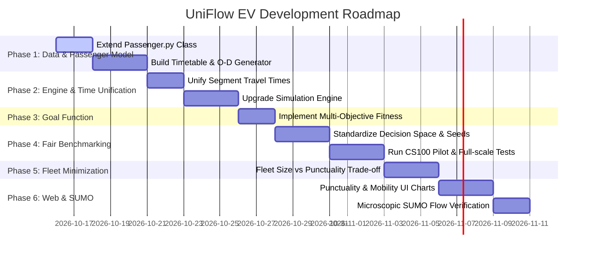

# 05. Implementation Roadmap and Action Plan (แผนปฏิบัติงานเชิงลึกและ Checklist)

> **เชื่อมโยง:** [[00_Index|หน้าหลัก]] | [[03_Advisor_Feedback_Deep_Dive|เจาะลึก Feedback อาจารย์]] | [[04_System_Architecture_and_Methodology|สถาปัตยกรรมระบบ]]

เอกสารนี้รวบรวมแผนงานทางวิศวกรรมซอฟต์แวร์ทีละขั้นตอน (Step-by-Step Engineering Action Plan) สำหรับนำ Feedback ของอาจารย์มาพัฒนาลงในโค้ดของโปรเจกต์จริง

---

## 📅 1. แผนการดำเนินงานแบ่งตามระยะ (Phase-by-Phase Roadmap)



---

## 🛠️ 2. รายละเอียดการแก้ไขโค้ดรายโมดูล (Detailed Code Refactoring Plan)

### 🔹 Phase 1: ปรับปรุง Passenger Data Model และเตรียม Demand จริง
- **ไฟล์เป้าหมาย:**
  1. `src/simulation/Passenger.py`
  2. `src/data/timetable.py` (สร้างใหม่)
  3. `src/config/building_mapping.py` (สร้างใหม่)

#### 1.1 การปรับปรุง `Passenger.py`
เพิ่มตัวแปรเพื่อบันทึกเวลาเรียน เวลาเดิน และการประเมินผลความตรงต่อเวลา:
```python
class Passenger:
    """Enhanced passenger tracking with punctuality and walking times."""
    def __init__(
        self,
        passenger_id: int,
        origin: str,
        destination: str,
        arrival_time: float,        # เวลาที่ผู้โดยสารมาถึงป้ายรถบัส (นาที)
        class_start_time: float,    # เวลาที่คาบเรียนเริ่ม (นาที เช่น 540 = 09:00 น.)
        walk_time_minutes: float = 3.0,  # เวลาเดินจากป้ายถึงห้องเรียน (นาที)
        buffer_time: float = 10.0,  # เวลาที่ต้องการถึงก่อนเรียน (นาที)
    ):
        self.passenger_id = passenger_id
        self.origin = origin
        self.destination = destination
        self.arrival_time = arrival_time
        self.class_start_time = class_start_time
        self.walk_time_minutes = walk_time_minutes
        self.buffer_time = buffer_time
        
        # Simulation execution state
        self.board_time: float | None = None
        self.drop_time: float | None = None
        self.building_arrival_time: float | None = None
        self.is_on_time: bool = False
        self.delay_minutes: float = 0.0

    def finalize(self):
        """คำนวณเวลาถึงอาคาร และประเมินการเข้าเรียนทัน/สาย"""
        if self.drop_time is not None:
            self.building_arrival_time = self.drop_time + self.walk_time_minutes
            self.delay_minutes = max(0.0, self.building_arrival_time - self.class_start_time)
            self.is_on_time = (self.building_arrival_time <= self.class_start_time)
```

#### 1.2 การสร้าง `src/data/timetable.py`
ดึงข้อมูลจาก `data/raw/real_data.xlsx` ร่วมกับตารางเรียน เพื่อสร้างรายการ Passenger Demand จริง โดยมีตารางเวลาเรียนยอดนิยม:
- คาบเช้า: 09:00 น. (นาทีที่ 540)
- คาบสาย: 11:00 น. (นาทีที่ 660)
- คาบบ่าย: 13:30 น. (นาทีที่ 810)

---

### 🔹 Phase 2: รวมศูนย์เวลาเดินทางและปรับปรุง Simulation Engine
- **ไฟล์เป้าหมาย:** `src/simulation/engine.py` และ `api_server.py`

#### 2.1 กำจัดการหารเฉลี่ยเวลารอบรถ
เปลี่ยนจาก:
```python
# โค้ดเดิม: หารเฉลี่ยเท่ากันทุกป้าย
travel_time = route_info.get("cycle_time", ...) / max(1, len(route_path) - 1)
```
เป็น:
```python
# โค้ดใหม่: คำนวณตามระยะทางจริงในกราฟ + Dwell time
def get_segment_travel_time(graph, from_stop, to_stop):
    try:
        dist_km = graph[from_stop][to_stop]["weight"] # หรือ shortest path
    except KeyError:
        dist_km = nx.shortest_path_length(graph, from_stop, to_stop, weight="weight")
    # ความเร็ว 50 km/h = 0.833 km/min
    drive_time_mins = (dist_km / 50.0) * 60.0
    return round(drive_time_mins, 2)
```

#### 2.2 อัปเกรด `run_simulation()`
- รองรับการรับ `passenger_demand_list` เข้ามาแทนการสุ่ม
- บันทึกผลลัพธ์สถิติที่ครอบคลุม:
  ```json
  {
      "avg_wait_time": 6.4,
      "avg_travel_time": 12.1,
      "served_passengers": 480,
      "unserved_passengers": 20,
      "on_time_passengers": 455,
      "late_passengers": 25,
      "on_time_rate_percent": 94.8,
      "avg_delay_minutes": 4.2,
      "total_buses_used": 12
  }
  ```

---

### 🔹 Phase 3: ปรับปรุงฟังก์ชันเป้าหมาย (Multi-Objective Fitness)
- **ไฟล์เป้าหมาย:** `src/optimization/fitness.py`

```python
def multi_objective_fitness(result: dict, total_buses: int) -> float:
    """
    Multi-objective cost function:
    Minimize Wait Time + Travel Time + Lateness Penalty + Unserved Penalty + Fleet Size
    Lower score is better.
    """
    total_passengers = result["served_passengers"] + result["unserved_passengers"]
    if total_passengers == 0:
        return 9999.0
        
    avg_wait = result["avg_wait_time"]
    avg_travel = result["avg_travel_time"]
    avg_delay = result.get("avg_delay_minutes", 0.0)
    unserved_ratio = result["unserved_passengers"] / total_passengers
    
    # Weight configuration
    w_wait = 0.25
    w_travel = 0.15
    w_delay = 0.35
    penalty_unserved = 50.0  # บทลงโทษสูงมากหากทิ้งผู้โดยสารตกค้าง
    cost_fleet = 1.2         # ค่าใช้จ่ายตามจำนวนรถ
    
    score = (
        (w_wait * (avg_wait / 10.0)) +
        (w_travel * (avg_travel / 15.0)) +
        (w_delay * (avg_delay / 10.0)) +
        (penalty_unserved * unserved_ratio) +
        (cost_fleet * total_buses)
    )
    return round(score, 4)
```

---

### 🔹 Phase 4: การเปรียบเทียบอัลกอริทึมอย่างเป็นธรรม (Fair Benchmark)
- **ไฟล์เป้าหมาย:** `src/algorithms/` (GA, SA, PSO, ACO) และ `run_benchmark.py`

#### 4.1 ข้อกำหนดการทดลองที่เป็นธรรม
1. **Evaluation Budget:** ทุกอัลกอริทึมได้รับสิทธิ์ประเมินฟังก์ชันเป้าหมายเท่ากันที่ $N = 500$ ครั้ง
2. **Replication & Seed:** รัน 5 รอบด้วย Seed: `[42, 123, 456, 789, 999]`
3. **การรายงานผล:** แสดงตารางเปรียบเทียบค่า Best, Worst, Mean, Std Dev
4. **ชุดทดลองนำร่อง (CS100 Pilot):**
   - 150 นักศึกษา เดินทางจาก `Dorm` ไป `SC2_SC3` สำหรับคาบ 09:00 น.
   - ยืนยันว่าตรรกะเวลาและการคัดกรองทำงานได้ถูกต้อง 100% ก่อนขยายสู่ระดับทั้งมหาวิทยาลัย

---

### 🔹 Phase 5: การทดลองลดทรัพยากรรถ (Fleet Sizing Trade-off)
- **สคริปต์:** `experiment_fleet_reduction.py`
- รันการจำลองซ้ำโดยกำหนดเพดานจำนวนรถ $N \in [20, 18, 16, 14, 12, 10, 8]$
- พล็อต **Pareto Front** แสดงความสัมพันธ์ระหว่าง `Number of Buses` กับ `On-Time Arrival Rate` และ `Average Waiting Time` เพื่อตอบคำถามเรื่องความคุ้มค่าและจุดสมดุล

---

### 🔹 Phase 6: อัปเกรดแดชบอร์ดและการตรวจสอบผ่าน SUMO
- **Frontend (`web/`):**
  - เพิ่มคอมโพเนนต์แสดงผลอัตราการเข้าเรียนทันเวลา (Punctuality Gauge & Chart)
  - เพิ่มแถบแสดงสถานะคิวสะสมในแต่ละนาที (Timeline Queue Length)
- **SUMO Integration (`src/models/`):**
  - ตรวจสอบความสอดคล้องระหว่างเวลาวิ่งใน Python Simulator กับ Microscopic Time ใน SUMO `tripinfo.xml`

---

## ✅ 3. ตารางตรวจสอบความพร้อมของระบบ (Readiness Checklist)

| ลำดับ | รายการตรวจสอบ | โมดูลที่เกี่ยวข้อง | เกณฑ์ผ่าน | สถานะ |
| :---: | :--- | :--- | :--- | :---: |
| 1 | ข้อมูลนักศึกษามีที่มาที่ไปจากหอพักจริง | `real_data.xlsx`, `timetable.py` | มี O-D Matrix อิงตามสถิติหอพักจริง | ⏳ รอทำ Phase 1 |
| 2 | Passenger Object บันทึกเวลาเรียนและการเดิน | `Passenger.py` | คำนวณ `delay_minutes` และ `is_on_time` ได้ | ⏳ รอทำ Phase 1 |
| 3 | เวลาเดินทางระหว่างป้ายอิงจากระยะทางจริง | `engine.py`, `graph.py` | ดึง Edge Weight จาก Graph ไม่หารเฉลี่ย | ⏳ รอทำ Phase 2 |
| 4 | Fitness Function ลงโทษคนตกค้างและคนสาย | `fitness.py` | ถ้าปล่อยคนตกค้าง คะแนนต้องแย่ลงอย่างมีนัยสำคัญ | ⏳ รอทำ Phase 3 |
| 5 | Benchmark ทำซ้ำ 5 Runs บน Budget เดียวกัน | `run_benchmark.py` | มี Mean/Std และกราฟการลู่เข้า | ⏳ รอทำ Phase 4 |
| 6 | มีชุดทดลองนำร่อง CS100 ตรวจสอบได้ง่าย | `test_cs100_pilot.py` | ยืนยันผลเบื้องต้นก่อนรันข้อมูลจริงทั้งระบบ | ⏳ รอทำ Phase 4 |
| 7 | มีผลการทดลองลดจำนวนรถ (Fleet Reduction) | `fleet_experiment.py` | มีกราฟ Trade-off ระหว่างจำนวนรถกับระดับบริการ | ⏳ รอทำ Phase 5 |
| 8 | หน้าเว็บแดชบอร์ดแสดงกราฟ Punctuality | `web/src/components/` | มีกราฟแท่ง/โดนัทแสดง สัดส่วน ทัน/สาย | ⏳ รอทำ Phase 6 |
| 9 | SUMO-GUI รันได้เสถียรบน Mac / XQuartz | `src/models/sumo.py` | รันผ่าน API `/api/simulation/run-sumo` ได้ไม่แครช | 🟢 เสร็จแล้ว |
